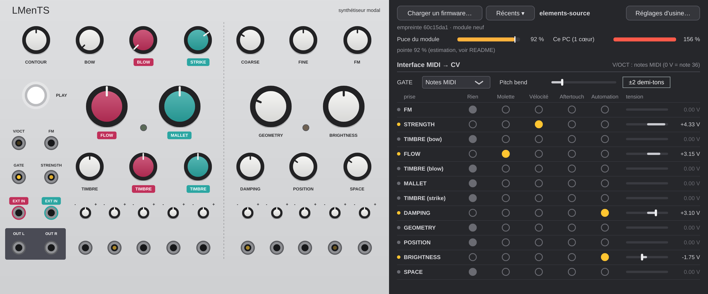

# LMenTS

Plugin VST3 pour Reason (Mac et Windows) : le **vrai firmware** du module Eurorack **Elements**
tourne dans une **émulation de sa puce** (STM32F405, processeur Cortex-M4F).
Ce n'est pas une imitation du son : c'est le programme du module, exécuté
instruction par instruction.

Projet indépendant, sans lien avec le fabricant du module.

## Où en est le projet

| Étape | Contenu | État |
|---|---|---|
| 1 | Processeur Cortex-M4F émulé, avec ses tests | fait |
| 2 | Périphériques de la puce, carte du module, plugin : le firmware démarre, les potards, les CV, les LED et le son marchent | fait (version d'essai) |
| 3 | Chargement des firmwares, mémoire séparée par firmware, sauvée dans le projet | fait |
| 4 | Temps d'accès mémoire, jauge d'occupation du processeur, craquements en cas de surcharge | fait |
| 5 | Optimisation, installateur Mac définitif, version Windows et son installateur | fait |
| 6 | Interface définitive (maquette D : façade + matrice MIDI → CV) | fait |

## Installer la version d'essai

Page **Releases** du dépôt, version « derniere-version ».

**Mac** (Apple Silicon et Intel) :

1. Télécharge **LMenTS.dmg** et ouvre-le.
2. Double-clique sur **Installer LMenTS**. La première fois, macOS refuse (LMenTS
   n'est pas signé par Apple) : **Réglages Système > Confidentialité et sécurité >
   Ouvrir quand même**.
3. Pour retirer LMenTS : **Désinstaller LMenTS**, dans le même .dmg.

**Windows** (64 bits) :

1. Télécharge **LMenTS-Windows-Installer.exe** et double-clique dessus.
2. Windows affiche « Windows a protégé votre ordinateur » (LMenTS n'est pas
   signé) : **Informations complémentaires**, puis **Exécuter quand même**.
3. Le plugin va dans `C:\Program Files\Common Files\VST3`, le dossier que lit
   Reason, et l'application dans `C:\Program Files\LMenTS`.
4. Pour retirer LMenTS : menu Démarrer > LMenTS > **Désinstaller LMenTS**, ou
   Paramètres > Applications.

Ensuite, sur les deux :

1. Relance Reason : LMenTS est dans **Plugins**, fabricant **Labtechno**.
2. Dans le plugin : **Charger un firmware…**, puis le fichier de mise à jour
   officiel du module (`elements_1.1.wav`), ou un `.bin`. On peut aussi déposer le
   fichier sur le plugin. Le firmware est ensuite gardé dans le projet Reason.

Une nouvelle version s'installe par-dessus l'ancienne, qui est retirée. La
désinstallation ne touche ni aux projets Reason ni aux fichiers de firmware.
Aucun firmware n'est fourni avec le plugin.

## Le plugin dans Reason



*Image faite par le programme d'essai (`LMENTS_SNAPSHOT=interface.png
plugin_test <firmware>`), avec le firmware recompilé, une note tenue, la molette
et deux prises en mode Automation.*

- **Façade** : les 27 potards du module, le bouton PLAY et ses trois voyants. Tous
  les potards et le bouton PLAY sont des paramètres automatisables.
- **Sorties** : OUT L et OUT R, en stéréo. Avec SPACE au minimum, comme sur le
  module, OUT L porte le son de l'excitateur seul et OUT R celui du résonateur seul.
- **Entrées audio** : l'entrée 1 du plugin est l'EXT IN rouge (côté BLOW),
  l'entrée 2 l'EXT IN turquoise (côté STRIKE). Dans Reason, elles sont à l'arrière
  du boîtier du plugin (touche Tab).
- **Panneau de droite** : en haut, le firmware (Charger un firmware…, Récents ▾,
  Réglages d'usine…), son empreinte et les jauges ; en dessous, l'**Interface
  MIDI → CV**.
- **Interface MIDI → CV** : les notes jouent sur V/OCT (0 V = note 36) et sur
  GATE. Les 12 autres prises CV forment une matrice : une ligne par prise, une
  colonne par source (Rien, Molette, Vélocité, Aftertouch, Automation). Un clic
  sur un point branche la source. La dernière colonne montre la tension reçue,
  en direct ; en mode Automation, c'est un curseur. Chaque prise a un paramètre
  automatisable, donc pilotable par le CV Programmer de Reason.
- **Accord** : avec COARSE à sa position par défaut, la note jouée au clavier est
  la note entendue (vérifié : la 3 = 220,0 Hz).
- **Jauges** : occupation de la puce du module (moyenne en barre, pointe en
  trait ; voir « La charge de la puce » ci-dessous) et part d'un cœur de ton
  ordinateur utilisée par l'émulation. En cas de surcharge, le plugin l'écrit en rouge.

## La charge de la puce

Le firmware calcule le son par blocs de 16 échantillons (un demi-milliseconde) :
chaque bloc doit être fini avant que le suivant ne soit joué. La jauge « Puce du
module » montre la part du temps que le firmware passe à calculer, en moyenne et
au pire bloc (la pointe). Si un bloc n'est pas prêt à temps, le son du module
craque, comme sur le vrai : rien n'est arrangé, c'est le transfert audio émulé
qui continue sans attendre le firmware. Le plugin l'écrit alors en rouge.

Pour estimer ce temps, l'émulateur compte les cycles d'horloge de chaque
instruction, plus les attentes de la mémoire flash :

- **flash** (manuel de référence du STM32F405) : 5 cycles d'attente à 168 MHz,
  cache d'instructions de 64 lignes de 16 octets, cache de données de 8 lignes,
  comme le firmware les règle. Chaque bloc de son fait passer environ 13 Ko de
  code : le cache (1 Ko) ne suffit pas, et la flash coûte environ 5 % du temps ;
- **instructions** : durées du manuel technique du Cortex-M4, y compris l'attente
  d'un cycle quand un calcul flottant sert à l'instruction suivante ; plus une
  mesure publiée sur un STM32F4 (des multiplications-additions qui se suivent
  coûtent 2 cycles au lieu de 3) ;
- **un choix recalé** : les chargements flottants qui se suivent sont comptés
  comme les chargements ordinaires (ils se chevauchent). Le manuel ne le dit pas ;
  ce choix est le seul qui respecte le repère connu ci-dessous.

**Le repère** : dans le code du firmware (voice.cc), l'auteur règle le résonateur
à 52 modes et note que 56 « tourne extrêmement juste ». Avec
`tools/build_firmware.sh`, on fabrique le même firmware avec 48 à 64 modes, et
on mesure le cas le plus lourd (note tenue très grave, trois excitateurs,
réverbération ; `machine_test <firmware> cpu`) :

| Modes du résonateur | Pointe de charge | Blocs manqués |
|---|---|---|
| 48 | 88 % | 0 |
| 52 (firmware officiel, recompilé) | 92 % | 0 |
| 52 (fichier officiel v1.1) | 94 % | 0 |
| 56 | 96 % | 0 |
| 60 | 99 % | 0 |
| 64 | 100 % | une centaine sur 2 s, son qui craque |

Ces chiffres restent une **estimation** : aucun n'a été mesuré sur un vrai
module. Avec les durées du manuel seules, le firmware officiel déborderait dans
ce cas lourd, ce que le vrai module ne fait pas.

## Firmwares et mémoire

- **Charger** : bouton « Charger un firmware… », menu « Récents ▾ » (les dix
  derniers fichiers ouverts sur cet ordinateur), ou fichier déposé sur le plugin. Formats :
  le `.wav` de mise à jour officiel, ou une image `.bin` (par exemple un firmware
  recompilé avec `tools/build_firmware.sh`).
- **Chaque firmware a sa propre mémoire**, comme un module qu'on mettrait à jour
  puis remettrait à jour : calibration, modèle de résonateur (appui long sur PLAY),
  mode caché. Un firmware est reconnu par son empreinte (affichée sous son nom).
  Revenir à un firmware déjà utilisé dans le projet lui rend sa mémoire ; un
  firmware nouveau démarre comme un module neuf.
- **Tout est sauvé dans le projet Reason** : le firmware chargé, sa mémoire, et
  celles des autres firmwares utilisés dans ce projet.
- **Réglages d'usine…** : efface la mémoire du firmware chargé et le redémarre
  comme un module neuf (les potards ne bougent pas).
- **Alertes** : si un firmware n'a pas démarré le son au bout de deux secondes, ou
  si son processeur s'arrête sur une erreur, le plugin l'écrit sous son nom.
- **La mémoire**, ce sont les secteurs de la flash qui ne contiennent pas le
  programme. Le firmware officiel n'utilise que le secteur 1 ; un firmware
  personnel peut en utiliser d'autres, ils sont gardés de la même façon.
- **Aucun firmware n'est fourni avec le plugin.** Le code d'Elements est sous
  licence MIT, mais le firmware officiel contient aussi un petit fichier sous
  licence GPL (`event_queue.h`, la file des appuis sur le bouton). Distribuer le
  fichier compilé obligerait à respecter aussi la GPL : par prudence, LMenTS ne
  fournit rien et chacun charge son fichier.

## Ce qui est vérifié à l'étape 1

Les tests sont dans `tools/armtests`. Un même programme, compilé pour la puce, est
exécuté par l'émulateur et par une référence ; les résultats doivent être identiques.

| Test | Référence | Résultat |
|---|---|---|
| 677 instructions entières et DSP, environ 5 000 jeux de valeurs chacune | QEMU | identique |
| 105 instructions de calcul à virgule, environ 58 000 jeux de valeurs chacune (4 modes d'arrondi, nombres limites, NaN, infinis) | QEMU | identique |
| Interruptions, y compris la sauvegarde des registres à virgule | QEMU | identique |
| Bibliothèque C et calcul à virgule, à 5 niveaux d'optimisation | le même code sur l'ordinateur | identique |
| Synthèse d'Elements (code du firmware, options de compilation du firmware) : 10 réglages, 20 secondes de son | QEMU | identique, bit pour bit |
| La même synthèse, comparée à l'ordinateur | le même code sur l'ordinateur | identique, bit pour bit (voir la note) |

QEMU ne sert que de référence pendant les tests : il n'y a aucun code de QEMU
dans le projet.

**Note sur la comparaison avec l'ordinateur.** Deux précautions sont nécessaires,
et elles montrent pourquoi émuler la puce vaut mieux que recompiler le code :

- le compilateur du firmware fusionne des multiplications et des additions (un seul
  arrondi au lieu de deux). Un ordinateur ne le fait pas aux mêmes endroits. Pour
  cette comparaison, les deux côtés sont compilés sans fusion. Avec la fusion du
  vrai firmware, l'écart de son reste minuscule (de 51 à 121 dB sous le signal) ;
- le mode caché « Ominous » convertit un nombre négatif en entier non signé. La
  puce donne 0, un ordinateur donne autre chose. La version ordinateur du test
  imite donc la puce sur cette ligne. Sans cela, le son d'« Ominous » recompilé
  pour un ordinateur est nettement différent de celui du module.

## Ce qui est vérifié à l'étape 2

| Essai | Résultat |
|---|---|
| Fichier officiel `elements_1.1.wav` : décodage | 1 664 paquets, toutes les sommes de contrôle justes |
| Démarrage du firmware officiel v1.1 | horloge réglée à 168 MHz, son à 32 001,2 Hz, codec réglé, réglages d'usine écrits en mémoire puis relus |
| Accord par V/OCT | une octave par volt (écart < 0,2 %), note attendue au réglage d'usine (277,4 Hz pour 277,2 Hz) |
| Bouton PLAY, entrée GATE, voyants | une note, les voyants suivent le son |
| EXT IN | un son envoyé fait sonner le résonateur |
| Plugin : notes MIDI, stéréo, CV, enregistrement et relecture du projet, hôte à 44,1 / 48 / 96 kHz | tout marche |
| Firmware recompilé depuis ses sources (outil `tools/build_firmware.sh`) | démarre et joue juste, comme l'officiel |

## Ce qui est vérifié à l'étape 3

| Essai (`tools/plugin_test.cpp`) | Résultat |
|---|---|
| Appui long sur PLAY, potards du résonateur au maximum | le firmware change de modèle de résonateur et l'enregistre en mémoire |
| Passage à un autre firmware | il démarre comme un module neuf, avec le modèle d'origine |
| Retour au premier firmware | il retrouve son modèle changé |
| Projet enregistré puis relu | firmware, modèle choisi, et mémoire de l'autre firmware retrouvés |
| Réglages d'usine | retour au modèle d'origine |
| Projet enregistré par la version de l'étape 2 | ses réglages sont repris |
| Faux firmware (une boucle sans fin) | chargé, puis signalé : « n'a pas démarré le son » |

## Ce qui est vérifié à l'étape 4

| Essai | Résultat |
|---|---|
| Processeur après l'ajout des durées et de la flash (`armtests`) | toujours identique à QEMU et à l'ordinateur, bit pour bit |
| Firmware officiel, réglage le plus lourd (`machine_test cpu`, `plugin_test`) | pointe 92 à 94 %, aucun bloc manqué |
| Firmware à 56 modes (« extrêmement juste » d'après l'auteur) | pointe 96 %, aucun bloc manqué |
| Firmware à 64 modes | blocs manqués, sauts dans le son, alerte « Surcharge » dans le plugin |
| Démarrage, accord, mémoire par firmware (étapes 2 et 3) | inchangés |

## Ce qui est vérifié à l'étape 5

| Essai | Résultat |
|---|---|
| Chemin rapide de l'émulateur (`machine_test fastpath`), firmware officiel recompilé et firmware à 64 modes | même son, échantillon par échantillon (204 800 sur 204 800), mêmes cycles, donc même jauge et même surcharge |
| Processeur après l'optimisation (`armtests`) | toujours identique à QEMU et à l'ordinateur, bit pour bit |
| Mac Apple Silicon et Mac Intel (Rosetta) : processeur (`run_prebuilt.sh`) | identique aux références |
| Windows : processeur (`run_prebuilt.sh`) | identique aux références |
| Windows : plugin (`plugin_test`, les mêmes essais que sur Mac) | tout marche : accord, stéréo, PLAY, EXT IN, CV, projet, mémoire par firmware, 44,1 / 96 kHz, surcharge signalée |
| Windows : installation, mise à jour (l'ancienne version est retirée), désinstallation (un fichier de l'utilisateur reste) | marche, essayé sur le PC de GitHub |
| Mac : installation, mise à jour, désinstallation | marche, essayé sur le Mac de GitHub |

**Vitesse** (part d'un cœur pour faire tourner le module en temps réel, plugin
au complet, mesurée sur les machines de GitHub) :

| Machine | Étape 4 | Étape 5 |
|---|---|---|
| Mac M1 (machine virtuelle de GitHub) | 114 à 134 % | 92 à 111 % |
| PC Windows de GitHub (machine virtuelle) | — | 62 à 102 % |

Au-dessus de 100 %, le son ne suivrait pas sur cette machine. Les chiffres
changent d'un essai à l'autre, car GitHub ne donne pas toujours la même machine,
et ces machines virtuelles sont lentes. Un M4 Max est nettement plus rapide
qu'un M1 cœur pour cœur, mais ce n'est **pas mesuré**.

### Ce qui n'est pas encore vérifié

- **Rien n'a été essayé dans Reason**, ni sur ton Mac, ni sur un PC Windows : les
  essais tournent sur GitHub, sans logiciel hôte.
- **La vitesse sur ton M4 Max** n'est pas mesurée (la jauge « Ce Mac » du plugin
  te la donnera ; sous Windows, elle s'appelle « Ce PC »).
- **Rien n'a été comparé à un vrai module.**
- **La jauge de la puce du module** est une estimation recalée sur un seul
  repère (voir « La charge de la puce »), pas une mesure.
- **L'électronique analogique** (étages d'entrée, convertisseur audio, sortie) est
  idéale : les valeurs viennent des réglages d'usine du firmware, pas des schémas.
- **Les installateurs ne sont pas signés** (ni par Apple, ni pour Windows) : il
  faut passer une fois par « Ouvrir quand même » ou « Exécuter quand même ».

## Ce qui est vérifié à l'étape 6

| Essai | Résultat |
|---|---|
| Interface dessinée par le programme d'essai (image ci-dessus) | la façade, le panneau du firmware, les jauges et la matrice s'affichent sans chevauchement |
| Matrice : sources branchées par les paramètres du plugin | le bon point s'allume, la tension reçue s'affiche en direct |
| Essais du plugin (étapes 2 à 5) | inchangés, sur Mac et Windows |

Non vérifié : le clic sur les points de la matrice et le curseur Automation
n'ont été essayés qu'à la lecture du code, pas à la souris, ni dans Reason.

## Refaire les tests

Sur Linux, avec `gcc-arm-none-eabi`, `libnewlib-arm-none-eabi`,
`libstdc++-arm-none-eabi-newlib` et `qemu-system-arm` :

```
bash tools/armtests/run_tests.sh
```

Sur Mac, sans rien installer d'autre que les outils de développement d'Apple (les
programmes de test sont fournis déjà compilés, avec leurs résultats de référence) :

```
bash tools/armtests/run_prebuilt.sh
```

Le même script marche sous Windows (Git Bash, avec Clang de LLVM).

GitHub lance tout cela à chaque envoi, puis fabrique et essaie le plugin et
ses installateurs sur un Mac et sur un PC Windows (onglet **Actions**).

Pour compiler le plugin soi-même : `cmake -B build` puis `cmake --build build
--config Release` sur Mac ; sous Windows, avec Visual Studio et son composant
« Clang » : `cmake -B build -A x64 -T ClangCL` (l'émulateur demande Clang, le
compilateur de Microsoft ne suffit pas).

## Organisation

| Dossier | Contenu |
|---|---|
| `Source/emu` | la puce virtuelle : processeur (`CortexM4.*`), calcul à virgule (`CortexM4Fpu.inc`, `SoftFloat.h`), carte du module (`ElementsMachine.*`), lecture des firmwares (`FirmwareFile.*`) |
| `Source/hw` | la façade : potards, prises et étages d'entrée (`Panel.h`) |
| `Source` | le plugin (`PluginProcessor.*`, `PluginEditor.*`) et la conversion de fréquence (`engine/Resampler.h`) |
| `tools` | essais du processeur (`armtests`), du module (`machine_test.cpp`), du plugin (`plugin_test.cpp`), recompilation du firmware (`build_firmware.sh`) |
| `installer` | fabrication des installateurs : Mac (`build_pkg.sh`), Windows (`windows/LMenTS.iss`, Inno Setup) |
| `firmware` | code source du firmware d'Elements, pour les tests et comme référence (voir `firmware/README.md`) |

## Licences

- Code du projet : licence MIT (voir `LICENSE`). Aucun code GPL.
- Firmware d'Elements et bibliothèque stmlib : Emilie Gillet, licence MIT.
- L'émulateur du processeur vient du projet Tresses (même auteur, licence MIT).
